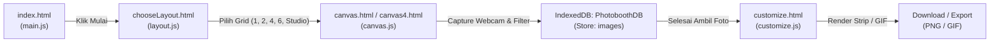

# Laporan Reverse Engineering: photobooth-io.cc

Laporan ini disusun menggunakan tools analisis REA (*Reverse Engineer Anything*) terhadap aplikasi web **https://photobooth-io.cc/**. Berkas kode sumber pihak ketiga telah dihapus demi kepatuhan hak cipta dan lisensi komersial. Repositori ini sepenuhnya menggunakan implementasi bersih (*clean-room reconstruction*) berbasis React + TypeScript di direktori [`src/`](./src/).

---

## 1. Arsitektur & Siklus Hidup Aplikasi (Lifecycle)

Aplikasi ini dibangun menggunakan arsitektur **Client-Side SPA / Multi-Page Vanilla JavaScript** yang beroperasi sepenuhnya di browser pengguna tanpa dependensi backend untuk pemrosesan gambar atau penyimpanan foto.

---

## 2. Rincian Modul & Komponen Kunci

### A. Navigasi & Pemilihan Layout (`layout.js`, `chooseLayout.html`)
1. **Inisialisasi Database:**
   * Membuka IndexedDB `PhotoboothDB` versi `1`.
   * Memastikan Object Store bernama `images` (`keyPath: "id", autoIncrement: true`) siap digunakan.
2. **State Reset Antar Sesi (`clearDBAndNavigate`):**
   * Sebelum berpindah ke halaman pemotretan, aplikasi mengeksekusi `store.clear()` agar foto dari sesi sebelumnya tidak bercampur.
3. **Peta Routing Layout:**
   * `#layout1Btn` $\rightarrow$ `canvas.html` (Single / 3-shot classic)
   * `#layout2Btn` $\rightarrow$ `canvas4.html` (4-grid strip)
   * `#layout3Btn` $\rightarrow$ `canvas2.html` (2-grid vertical)
   * `#layout4Btn` $\rightarrow$ `canvas6.html` (6-grid)
   * `#studioModeL5Btn` $\rightarrow$ `studio-mode.html`

---

### B. Pengambilan Foto & Pemrosesan Kamera (`canvas.js`, `canvas.html`)
1. **Manajemen Stream Kamera (`startCamera`, `stopCameraStream`):**
   * Memeriksa `navigator.mediaDevices.getUserMedia`.
   * Mendukung pemilihan perangkat input (`enumerateDevices` $\rightarrow$ `cameraOptions`).
   * Tombol Mirror / Invert: Mengubah orientasi horizontal kamera menggunakan CSS transform `scaleX(-1)`.
2. **Siklus Pemotretan (`startPhotobooth`, `showCountdown`):**
   * Menjalankan timer countdown visual di layar (3, 2, 1).
   * Animasi lampu kilat (*shutter flash*) dengan memanipulasi opasitas elemen `#flash`.
   * Mengambil cuplikan frame video langsung ke elemen `<canvas>` internal.
3. **Filter Efek Visual Realtime & Post-Capture:**
   * Filter bawaan: B&W, Sepia, Smooth, Vintage, Old Film, VHS.
   * Efek shader prosedural di atas canvas 2D:
     * `drawFilmScratches`: Garis goresan film analog acak.
     * `applyChromaticAberration`: Efek glitch warna RGB split.
     * `drawScanlines`: Efek scanline monitor tabung / CRT.
     * `applyToneCurve`: Transformasi tone warna & kontras.
     * Integrasi CamanJS (`caman.full.min.js`) sebagai mesin filter sekunder.
4. **Penyimpanan Frame Sementara:**
   * Foto disimpan ke IndexedDB `PhotoboothDB` (store `images`).
   * Menyimpan rute kembali: `sessionStorage.setItem('returnLayout', 'canvas.html')`.
   * Melakukan navigasi otomatis ke `customize.html`.

---

### C. Studio Kustomisasi & Ekspor Final (`customize.js`, `customize.html`)
1. **Layout Switcher & Photo Re-Order:**
   * Memuat modul `js/layout-switcher.js`, `js/layout-catalog.js`, dan `js/photo-reorder.js`.
   * Memungkinkan pengguna menukar urutan foto (drag/reorder) atau mengganti rasio strip tanpa mengulang pemotretan.
2. **Kalkulasi & Geometri Canvas Strip (`buildPhotoStripCanvas`):**
   * **Ukuran Strip 4-Foto:** Lebar `624 px`, Tinggi `1800 px`.
   * **Ukuran Strip 3-Foto:** Lebar `592 px`, Tinggi `1352 px`.
   * **Margin & Padding:**
     * `borderWidth = 30 px`
     * `spacing = 12 px`
     * `bottomPadding = 100 px`
   * **Rumus Posisi Gambar:**
     $$\text{availableHeight} = \text{canvasHeight} - (2 \times \text{borderWidth}) - (2 \times \text{spacing}) - \text{bottomPadding}$$
     $$\text{photoHeight} = \frac{\text{availableHeight}}{\text{imageArrayLength}}$$
     $$\text{photoWidth} = \text{canvasWidth} - (2 \times \text{borderWidth})$$
3. **Pewarnaan & Background Frame:**
   * Mendukung warna solid (menggunakan picker `vanilla-picker.min.js`) atau latar belakang motif gambar (`backgroundImage` via `drawImageCover`).
   * Stempel Waktu (Date/Time): Otomatis mendeteksi kontras warna background untuk memilih warna teks (`#ffffff` vs `#000000`).
4. **Generator Animasi GIF:**
   * Menggunakan pustaka `gif.js` untuk menggabungkan frame-frame foto menjadi animasi looping bergerak.
5. **Ekspor & Download (`downloadCanvasCopy`):**
   * Mengonversi canvas hasil tumpukan ke PNG DataURL (`stackedCanvas.toDataURL('image/png')`).
   * Menggunakan fallback Blob URL untuk kompatibilitas iOS Safari.
   * Memicu download otomatis dengan nama file default `photobooth.png`.

---

## 3. Hasil Pemetaan Modul Target (Telah Dibersihkan)

Berkas-berkas mentah yang diekstraksi dari target telah dihapus dari repositori untuk mencegah masalah hak cipta / lisensi komersial. Rangkuman fungsi masing-masing komponen asli yang telah dipelajari dan diimplementasikan ulang secara orisinal pada [`src/`](./src/):

| Modul Asli | Komponen Pengganti (Clean-Room Rebuild di `src/`) | Deskripsi Fungsi |
| :--- | :--- | :--- |
| `main.js` | [`src/components/Header.tsx`](./src/components/Header.tsx) | Navigasi studio, reset sesi, dan indikator alur. |
| `layout.js` | [`src/components/LayoutSelector.tsx`](./src/components/LayoutSelector.tsx) & [`src/config/layouts.ts`](./src/config/layouts.ts) | Definisi spesifikasi grid 4-strip, 3-strip, 2-mini, dan 2x2. |
| `canvas.js` | [`src/hooks/useCamera.ts`](./src/hooks/useCamera.ts) & [`src/components/CaptureStudio.tsx`](./src/components/CaptureStudio.tsx) | Engine WebRTC stream kamera, countdown timer, audio shutter sintetis, dan mirror flip. |
| `customize.js` | [`src/utils/canvasRenderer.ts`](./src/utils/canvasRenderer.ts) & [`src/components/CustomizeStudio.tsx`](./src/components/CustomizeStudio.tsx) | Algoritma kompilasi canvas strip piksel-presisi, filter visual procedural, dan ekspor PNG resolusi tinggi. |
